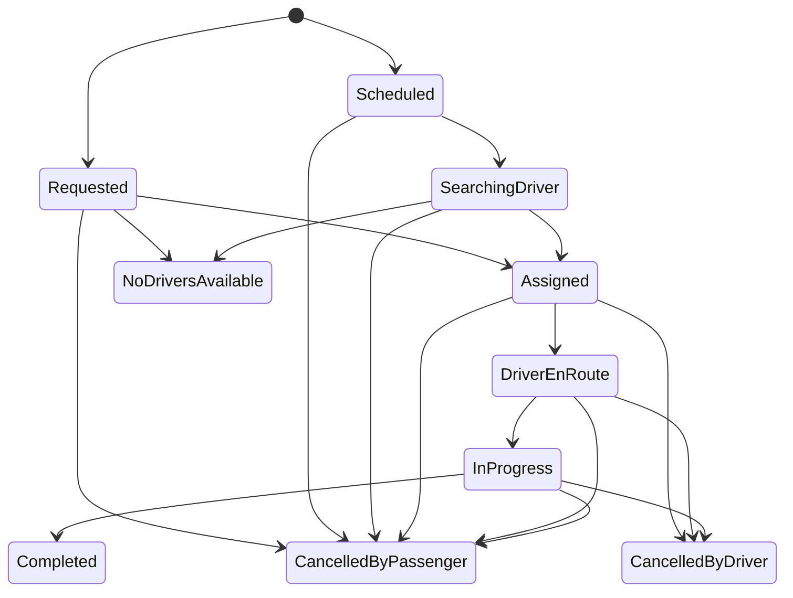

# Modelo de dominio — primera iteración

Esta versión documenta el núcleo implementado en `Trips.Domain`. La persistencia, compromisos de chofer y asignación concurrente se completarán en M4 y deberán quedar respaldados por ADR y pruebas con PostgreSQL real.

## Entidades y value objects

| Elemento | Responsabilidad | Invariantes actuales |
|---|---|---|
| `Trip` | Representa el ciclo de vida de un viaje | pasajero obligatorio, origen/destino distintos, tarifa estimada no negativa |
| `TripState` | Estados del viaje | las transiciones se validan en `TripStateMachine` |
| `Money` | Importes exactos | centavos no negativos, moneda ISO de tres letras mayúsculas |
| `GeoPoint` | Coordenada geográfica | latitud [-90, 90], longitud [-180, 180], valores finitos |

## Estados

Los estados terminales son `Completed`, `CancelledByPassenger`, `CancelledByDriver` y `NoDriversAvailable`. La asignación concurrente y los compromisos temporales del chofer no pertenecen todavía a esta iteración: se resolverán en M4 mediante el mecanismo aprobado en el ADR correspondiente.

## Reglas de diseño

- `Trips.Domain` no referencia frameworks web, base de datos ni paquetes externos.
- Los errores de dominio se expresan como `DomainException`; su traducción a HTTP corresponde a la capa API.
- El tiempo de viajes programados se recibe explícitamente para que los tests no dependan del reloj del sistema.
- El dinero se representa en centavos enteros, nunca con `float` o `double`.

